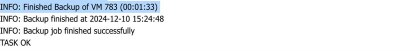
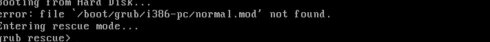
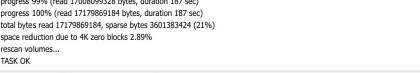
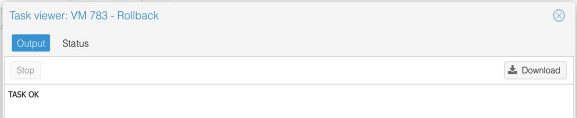

# Proxmox Virtualization, Backup, and Recovery

**Francisca Tupkeyi · CTI1301 Virtualization and Cloud Operations · December 2024**

I used Proxmox VE to provision and maintain Linux and Windows virtual machines, then tested two recovery methods on an Ubuntu VM. I restored a backup after a simulated boot failure and ran a separate snapshot rollback to verify that changes made after the snapshot were reverted.

## Featured lab · Recovering an Ubuntu VM

| Stage | What I did | What the evidence shows |
| --- | --- | --- |
| Backup | Backed up the Ubuntu VM in Proxmox. | The backup task completed successfully. |
| Failure | Induced a boot failure on the lab VM. | The VM console displayed the boot failure. |
| Restore | Restored the Ubuntu VM from its backup. | The Proxmox restore task completed successfully. |
| Snapshot rollback | Took a snapshot, changed the guest state, and rolled back. | Proxmox reported a successful rollback, and the final desktop capture showed the earlier state. |

A backup restore recovers a VM from a saved copy. A snapshot rollback returns the existing VM to an earlier state. For a recovery drill, I would also record how long the restore took and verify the restored guest by booting it and checking its services. The backup-restore evidence here captures the completed Proxmox task.

## Recovery evidence

| Backup complete | Boot failure |
| --- | --- |
|  |  |

| Restore complete | Snapshot rollback complete |
| --- | --- |
|  |  |

*These highlights come from my [Lab 4 coursework evidence](labs/04-clones-snapshots-and-recovery.pdf), which includes my title slide and the four task and console captures in sequence.*

## Coursework evidence by lab

The full submission PDFs include every original page and screenshot. Visible password values are redacted. The shorter evidence PDFs highlight selected screenshots for a quick review.

| Lab | What I documented | Selected evidence | Full original submission |
| --- | --- | --- | --- |
| **1 · Ubuntu** | Provisioned an Ubuntu VM, checked its network configuration, and recorded its Proxmox hardware and options. | [View Lab 1 evidence](labs/01-ubuntu.pdf) | [Open full PDF](original-labs/01-ubuntu.pdf) |
| **2 · Windows Server and Rocky Linux** | Provisioned Windows Server 2019 and Rocky Linux. Configured a second virtual disk for each guest and verified it in the operating system. | [View Lab 2 evidence](labs/02-windows-server-and-rocky-linux.pdf) | [Open full PDF](original-labs/02-windows-server-and-rocky-linux.pdf) |
| **3 · System maintenance** | Documented cold and live migration of Ubuntu. Applied updates and captured backups for Ubuntu, Rocky Linux, and Windows Server 2019. | [View Lab 3 evidence](labs/03-system-maintenance.pdf) | [Open full PDF](original-labs/03-system-maintenance.pdf) |
| **4 · Clones, snapshots, and recovery** | Created an Ubuntu clone and template, provisioned a full clone from the template, backed up a Bitnami WordPress VM, and tested Ubuntu restore and rollback. | [View Lab 4 evidence](labs/04-clones-snapshots-and-recovery.pdf) | [Open full PDF](original-labs/04-clones-snapshots-and-recovery.pdf) |
| **4.5 · Docker and WordPress** | Verified Docker service status and running containers, then documented WordPress installation, the admin portal, and the published lab site. | [View Lab 4.5 evidence](labs/04-5-docker-and-wordpress.pdf) | [Open full PDF](original-labs/04-5-docker-and-wordpress.pdf) |
| **5 · Windows 10 Pro** | Configured a Windows 10 Pro VM and verified that Proxmox recognized its QEMU Guest Agent. | [View Lab 5 evidence](labs/05-windows-10-pro.pdf) | [Open full PDF](original-labs/05-windows-10-pro.pdf) |
| **6 · File sharing** | Accessed a Windows Server share from Windows 10 and Ubuntu, then verified the saved changes from the server. | [View Lab 6 evidence](labs/06-file-sharing.pdf) | [Open full PDF](original-labs/06-file-sharing.pdf) |

## Related projects

- [Cybersecurity Home Lab](https://github.com/FinaSec/Cybersecurity_Home_LAb) · Windows hardening and logon auditing
- [Web01 SOC Investigation](https://github.com/FinaSec/web01-soc-investigation) · Correlating packet captures and web server logs
